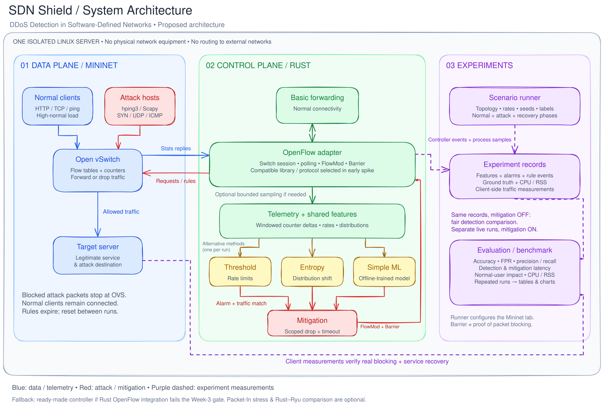

# SDN Shield
## DDoS Detection in Software-Defined Networks

SDN Shield is a research project that aims to monitor network traffic in real time, detect potential DDoS attacks, and automatically block them using OpenFlow rules. The project plans to develop a Rust-based SDN controller and compare threshold-based, entropy-based, and simple machine learning approaches under the same traffic scenarios.

**Status:** Planning stage. This repository does not yet contain a working controller, setup scripts, or experimental results.

## Objectives and scope

- Build a virtual network on a single Linux server using Mininet and Open vSwitch.
- Observe normal and attack traffic through a shared measurement pipeline.
- Compare three detection methods in terms of accuracy, false alarms, response time, and resource consumption.
- Measure the impact on legitimate users while blocking attack traffic.
- Run reproducible experiments with controlled scenarios and recorded configurations.

The initial scope covers DDoS traffic directed at hosts in the network. Attacks directly targeting the controller are out of scope. A high-volume Packet-In scenario and a Rust–Ryu comparison will be added only if the main objectives are completed.

## Planned architecture

The controller must also provide basic forwarding for normal traffic. Detection and mitigation will be built on top of this functioning network.

### Technologies

| Component | Planned technology |
| --- | --- |
| Controller | Rust and a suitable existing OpenFlow library |
| Virtual network | Mininet |
| Virtual switch | Open vSwitch |
| Attack simulation | hping3; Scapy when needed |
| Normal traffic | HTTP/TCP clients, iperf3, and ping |
| ML | A simple classifier; logistic regression is the initial candidate |
| Fallback controller | Ryu or another ready-made controller with verified compatibility |
| Experiment environment | A single, isolated Linux server |

The OpenFlow version and Rust library will be selected through an early compatibility experiment. Software versions will be pinned and setup commands added after the first working prototype.

### Controller decision gate

The Rust integration will first be validated for switch connectivity, basic forwarding, statistics collection, and drop-rule installation. If this workflow is not reliable by the **end of Week 3**, the project will switch to a ready-made controller. The Rust detection component will be retained where feasible; completing the three-method comparison and mitigation experiments takes priority.

## Detection methods

All methods will be evaluated using the same observation windows, available features, and experiment records. Window length, polling interval, and alarm parameters will be configurable and recorded with each experiment.

| Method | Approach | Key consideration |
| --- | --- | --- |
| Threshold-based | Detect packet-per-second and byte-per-second rates exceeding calibrated thresholds | High-volume legitimate traffic may trigger false alarms. |
| Entropy-based | Compare the entropy of source/destination address or port distributions against a normal traffic profile | An increase or decrease in entropy alone does not prove an attack; the direction and threshold must be validated for each scenario. |
| Simple ML | Classify normal and attack traffic using shared features | Training, validation, and test splits must be separated by experiment run to prevent data leakage. |

Features will be derived from differences between successive counter readings. Counter resets and expired flows will be accounted for. Aggregate port counters do not provide address distributions or TCP SYN ratios; these features require suitable flow counters or bounded packet sampling. Unobservable features will not be assumed to be available.

Thresholds, entropy reference profiles, and ML parameters will be selected using training/calibration data only and frozen before testing. ML training is planned to run outside the controller, with only inference running during experiments.

## Traffic scenarios

| Scenario | Purpose |
| --- | --- |
| Normal low/moderate traffic | Establish baseline behavior and resource consumption |
| High-volume legitimate traffic | Measure false alarms and user impact under legitimate load |
| SYN flood | Evaluate behavior under TCP connection-initiation traffic |
| UDP flood | Evaluate detection and blocking of high-volume UDP traffic |
| ICMP flood | Evaluate detection and blocking of high-volume ICMP traffic |
| Attack + legitimate user traffic | Measure the impact of mitigation on legitimate users |

DDoS scenarios will use multiple attacker hosts sending traffic to the same target. Each run will record the start of normal traffic, attack onset, attack end, and recovery time. Attack rates and attacker counts will be varied in a controlled manner.

**Safety:** Attack simulations will run only in an authorized, isolated Mininet environment. Routing from lab hosts to external networks will remain disabled, and traffic rates and experiment durations will be bounded.

## Automatic mitigation

1. Record the detection result and the associated traffic group.
2. Send a high-priority OpenFlow drop rule targeting traffic associated with the attack.
3. Check rule-processing order using a Barrier reply and verify actual blocking through data-plane traffic measurements.
4. Give rules a limited lifetime; clean them up after each experiment and measure normal traffic recovery.

A Barrier reply alone does not prove that packets are being blocked. A source address alone is not a reliable attacker identity either; spoofing and clients sharing addresses require additional validation of rule matches and legitimate traffic impact. Blocking all traffic to the target will not count as successful mitigation.

## Metrics and experimental methodology

| Metric | Measurement |
| --- | --- |
| Detection accuracy | `(TP + TN) / (TP + TN + FP + FN)`; also report precision, recall, and F1 |
| False positive rate | `FP / (FP + TN)` over attack-free windows |
| Detection latency | Time from attack onset to the first correct alarm |
| Mitigation latency | Time from the alarm to observed blocking in the data plane |
| Total response time | Time from attack onset to effective blocking |
| Legitimate user impact | Changes in throughput, latency, packet loss, and successful request rate |
| Controller resource usage | Process CPU usage and RSS memory; average and peak values |

- Ground-truth labels will come from attack-script logs; the window-labeling rule will be defined in advance.
- For a fair algorithm comparison, detection will first be evaluated on the same records with mitigation disabled. Each method will then undergo separate end-to-end runs with mitigation enabled.
- Topology, traffic profiles, polling intervals, hardware, software versions, and random seeds will be fixed or recorded.
- Each experiment will be repeated independently at least five times. Run order will be varied, and medians and distributions will be reported.
- Undetected attacks will not be excluded from results; they will be reported separately as missed attacks.
- Statistics and timing measurements will use a common time base; durations will be measured with a monotonic clock.
- Traffic generation and the controller share resources on a single server, so CPU placement and server load will be recorded. Results will not be presented as claims about physical network capacity.

## Team and responsibilities

| Team member | Primary responsibility |
| --- | --- |
| Semih Berkay Öztürk | Rust controller and OpenFlow integration |
| Baki Kerem Artan | DDoS detection algorithms |
| Mustafa Safa Bayrak | Mininet/Open vSwitch environment and attack scenarios |
| Hammad Ali Khan | Mitigation, measurements, and benchmark infrastructure |

Shared responsibilities include defining feature and event-record formats, integration testing, interpreting results, and preparing the final report.

## Expected deliverables

- A working controller and automatic mitigation prototype.
- Implementations of three detection methods.
- A reproducible Mininet topology and controlled traffic scenarios.
- Raw experiment records, metric calculations, and comparison charts.
- A final report and demonstration documenting limitations and threats to validity.

## Project timeline

[Proposed 12-week project timeline](TIMELINE.md). Weeks are relative because the start date and submission deadline have not been specified.
