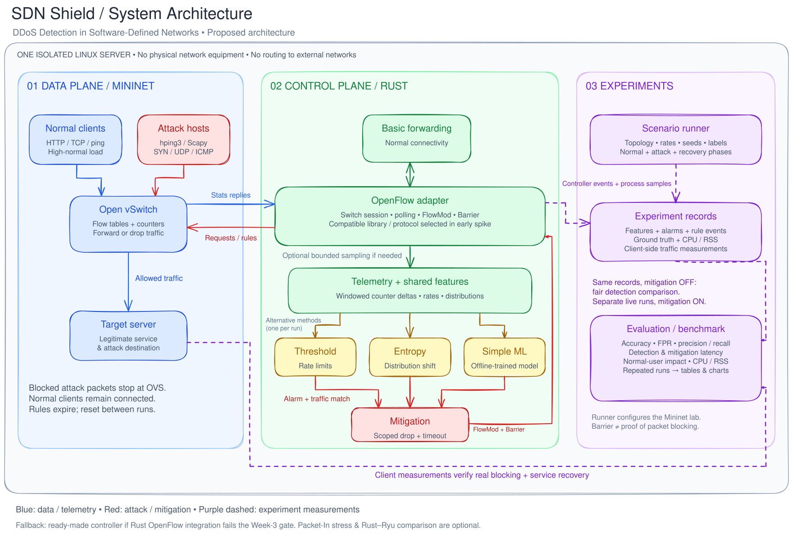

# SDN Shield
## DDoS Detection in Software-Defined Networks

SDN Shield is a research project that aims to monitor network traffic in real time, detect potential DDoS attacks, and automatically block them using OpenFlow rules. The project plans to develop a Rust-based SDN controller and compare threshold-based, entropy-based, and simple machine learning approaches under the same traffic scenarios.

**Status:** The Rust OpenFlow 1.3 controller supports forwarding, on-demand flow counters, and a controlled timed-drop/recovery demo. Automatic DDoS detection/mitigation, periodic statistics collection, and research benchmarks are not implemented yet.

## Run the network smoke test

Install Docker Engine with Docker Compose, or a Mac container runtime. Start the Docker engine, then run this command from the repository root:

```sh
docker compose up --build --exit-code-from lab
```

No Modal account, host Python installation, or physical network equipment is required. The first build needs internet access to download the Debian/Rust images, system packages, and locked Cargo dependencies. Rust compilation and protocol tests happen inside the Docker build; no host Rust installation is required. The test container itself runs with networking disabled (`network_mode: none`), no published ports, and no Docker socket mount.

The test uses eight Mininet hosts, one kernel-backed OVS switch, and the Rust controller with OpenFlow 1.3. It checks:

- Linux network namespaces, veth creation, and traffic shaping.
- No default IPv4 route or active external interface in any Mininet host.
- Direct OVS forwarding: 56/56 successful ping probes.
- No forwarding when both the controller and flow rules are absent: 0/2 probes received (expected).
- Controller-managed forwarding: 56/56 successful ping probes, with installed OpenFlow rules.
- A TCP transfer targeting 500 Kbit/s, with each link capped at 1 Mbit/s.
- Rust reads a forwarding flow's cumulative packet/byte counters before and after traffic and verifies an increase.
- A six-second drop rule blocks only `h1 -> h8` IPv4 ICMP echo requests on h1's ingress port: 0/2 ping replies.
- Legitimate `h5 -> h8` traffic still receives 2/2 replies; the drop rule's counters increase.
- The drop rule expires without an explicit delete, and `h1 -> h8` receives 2/2 replies again.

Success prints `ALL NETWORK SMOKE TESTS PASSED` and returns exit code 0. The container has a 180-second runtime limit, 2 CPUs, and 2 GiB of memory. Mininet may warn that it cannot tune all kernel resource limits inside the container; the connectivity assertions still run. This is a functional connectivity/mitigation test, not a DDoS or performance benchmark.

The combined setup/test log is saved to `runs/docker-smoke/test.log` and overwritten on each run. Each Rust mitigation test also creates `runs/docker-smoke/mitigation-<run-id>/events.jsonl` using the shared event logger. It records raw flow snapshots, the rule request and Barrier acknowledgement, packet probes, expiry, and recovery with wall-clock and monotonic timestamps. Probe timing is an observation bound, not a precise mitigation-latency benchmark. These logs are ignored by Git. After the test, remove the stopped Compose container with:

```sh
docker compose down
```

**Compatibility:** Verified on an Apple Silicon Mac using OrbStack's ARM64 Docker engine. Docker Desktop and native Linux Docker have not been verified. The Docker engine's Linux kernel must provide OVS datapath support; installing OVS packages in the container alone does not provide that kernel support. There is no automatic userspace fallback.

**Security:** The lab requires `privileged: true` to manage its network namespaces and interfaces. This weakens container isolation even though external networking is disabled. Run only trusted project code on a development machine, not a production Docker host.

To repeat the smoke test with the OVS test controller instead, after building the image:

```sh
docker compose run --rm lab --controller ovs
```

An optional Modal VM runner remains available through `uv run env/modal_smoke_test.py` (requires `uv` and Modal authentication). It explicitly uses the OVS test controller as an infrastructure baseline; it does not build or test the Rust controller. The OVS/Modal paths run only the connectivity checks, not the Rust counter/drop demo. Both runners use the same test in `env/network_smoke_test.py`.

## Rust controller prototype

The Cargo project is in `controller/`. It uses [`rovs-openflow` 0.2.0](https://docs.rs/rovs-openflow/0.2.0/rovs_openflow/) for OpenFlow message parsing and encoding, with standard-library TCP for accepting the switch connection. The crate's `VConn` API initiates outgoing connections, so it is not used as a controller listener.

The prototype:

- Listens on `127.0.0.1:6653` by default; an optional positional argument changes the listening address.
- Exchanges Hello/Features messages, answers Echo requests, and confirms table-miss rule setup with a Barrier reply.
- Learns source MAC addresses from Packet-In messages and floods unknown/broadcast destinations with Packet-Out.
- Installs unicast rules matching ingress port, source MAC, and destination MAC. Known unicast traffic stays in OVS, not in the Rust process.
- Gives learned flows a 30-second idle timeout and 60-second hard timeout, and limits the MAC cache to 4096 entries.
- Checks frame lengths, protocol version, ingress ports, and Ethernet data. Invalid messages close the switch session and are logged; the listener can accept a new connection.
- Reads multipart flow-statistics replies and installs narrowly matched, non-permanent drop rules through the local OVS management socket.

The Docker image runs the protocol tests before building the release binary. With Rust installed on macOS/Linux, run them with:

```sh
cargo test --locked --manifest-path controller/Cargo.toml
```

For a Linux lab outside Docker, the controller can be started with:

```sh
cargo run --release --locked --manifest-path controller/Cargo.toml -- 127.0.0.1:6653
```

In a running Linux lab, the binary also provides these management commands (the socket requires appropriate local permissions, usually root):

```sh
sdn-shield-controller stats /var/run/openvswitch/s1.mgmt
sdn-shield-controller drop /var/run/openvswitch/s1.mgmt 1 10.0.0.1 10.0.0.8 6
```

The binary is installed on PATH in the Docker image; for a native build use `controller/target/release/sdn-shield-controller`. The commands open a separate local OpenFlow 1.3 connection while the main forwarding controller continues running. `stats` prints `FLOW_STATS` records with cumulative counters, flow duration, and match fields; it does not calculate rates. It accepts at most 16,384 entries across 256 multipart replies. The existing library builds the request and decodes entries; entry/match lengths are validated before decoding.

`drop SOCKET IN_PORT SOURCE_IPV4 DESTINATION_IPV4 SECONDS` installs a priority-100 rule matching that ingress port, exact IPv4 source/destination, and ICMP echo-request type. Its hard timeout must be 1..65535 seconds. No forwarding instructions means drop. `DROP_BARRIER_ACK` confirms only switch processing order; the smoke test separately verifies actual packet loss and recovery. These are manual integration tools, not an automatic attack detector.

**Prototype limits:** One main switch connection is served at a time, with OpenFlow 1.3 and an untagged, static, loop-free topology. There is no TLS/authentication, MAC aging, or MAC-move/port-down handling. VLAN-tagged packets are rejected. Management uses local Unix sockets with five-second I/O timeouts. Use only in the isolated lab.

## Objectives and scope

- Build a virtual network on a single Linux server using Mininet and Open vSwitch.
- Observe normal and attack traffic through a shared measurement pipeline.
- Compare three detection methods in terms of accuracy, false alarms, response time, and resource consumption.
- Measure the impact on legitimate users while blocking attack traffic.
- Run reproducible experiments with controlled scenarios and recorded configurations.

The initial scope covers DDoS traffic directed at hosts in the network. Attacks directly targeting the controller are out of scope. A high-volume Packet-In scenario and a Rust–Ryu comparison will be added only if the main objectives are completed.

## Planned architecture



The controller must also provide basic forwarding for normal traffic. Detection and mitigation will be built on top of this functioning network.

### Technologies

| Component | Planned technology |
| --- | --- |
| Controller | Rust with `rovs-openflow` 0.2.0 |
| Virtual network | Mininet |
| Virtual switch | Open vSwitch |
| Attack simulation | hping3; Scapy when needed |
| Normal traffic | HTTP/TCP clients, iperf3, and ping |
| ML | A simple classifier; logistic regression is the initial candidate |
| Fallback controller | Ryu or another ready-made controller with verified compatibility |
| Experiment environment | A single, isolated Linux server |

OpenFlow 1.3 and `rovs-openflow` 0.2.0 have passed the initial forwarding compatibility test. Cargo dependencies are recorded in `controller/Cargo.lock`; Docker uses Rust 1.92.0 and a Debian Bookworm runtime. System package versions are printed in the smoke-test log.

### Controller decision gate

The Rust integration will first be validated for switch connectivity, basic forwarding, statistics collection, and drop-rule installation. If this workflow is not reliable by the **end of Week 3**, the project will switch to a ready-made controller. The Rust detection component will be retained where feasible; completing the three-method comparison and mitigation experiments takes priority.

## Detection methods

All methods will be evaluated using the same observation windows, available features, and experiment records. Window length, polling interval, and alarm parameters will be configurable and recorded with each experiment.

| Method | Approach | Key consideration |
| --- | --- | --- |
| Threshold-based | Detect packet-per-second and byte-per-second rates exceeding calibrated thresholds | High-volume legitimate traffic may trigger false alarms. |
| Entropy-based | Compare the entropy of source/destination address or port distributions against a normal traffic profile | An increase or decrease in entropy alone does not prove an attack; the direction and threshold must be validated for each scenario. |
| Simple ML | Classify normal and attack traffic using shared features | Training, validation, and test splits must be separated by experiment run to prevent data leakage. |

Features will be derived from differences between successive counter readings. Counter resets and expired flows will be accounted for. Aggregate port counters do not provide address distributions or TCP SYN ratios; these features require suitable flow counters or bounded packet sampling. Unobservable features will not be assumed to be available.

Thresholds, entropy reference profiles, and ML parameters will be selected using training/calibration data only and frozen before testing. ML training is planned to run outside the controller, with only inference running during experiments.

## Traffic scenarios

| Scenario | Purpose |
| --- | --- |
| Normal low/moderate traffic | Establish baseline behavior and resource consumption |
| High-volume legitimate traffic | Measure false alarms and user impact under legitimate load |
| SYN flood | Evaluate behavior under TCP connection-initiation traffic |
| UDP flood | Evaluate detection and blocking of high-volume UDP traffic |
| ICMP flood | Evaluate detection and blocking of high-volume ICMP traffic |
| Attack + legitimate user traffic | Measure the impact of mitigation on legitimate users |

DDoS scenarios will use multiple attacker hosts sending traffic to the same target. Each run will record the start of normal traffic, attack onset, attack end, and recovery time. Attack rates and attacker counts will be varied in a controlled manner.

**Safety:** Attack simulations will run only in an authorized, isolated Mininet environment. Routing from lab hosts to external networks will remain disabled, and traffic rates and experiment durations will be bounded.

## Automatic mitigation

1. Record the detection result and the associated traffic group.
2. Send a high-priority OpenFlow drop rule targeting traffic associated with the attack.
3. Check rule-processing order using a Barrier reply and verify actual blocking through data-plane traffic measurements.
4. Give rules a limited lifetime; clean them up after each experiment and measure normal traffic recovery.

A Barrier reply alone does not prove that packets are being blocked. A source address alone is not a reliable attacker identity either; spoofing and clients sharing addresses require additional validation of rule matches and legitimate traffic impact. Blocking all traffic to the target will not count as successful mitigation.

## Metrics and experimental methodology

| Metric | Measurement |
| --- | --- |
| Detection accuracy | `(TP + TN) / (TP + TN + FP + FN)`; also report precision, recall, and F1 |
| False positive rate | `FP / (FP + TN)` over attack-free windows |
| Detection latency | Time from attack onset to the first correct alarm |
| Mitigation latency | Time from the alarm to observed blocking in the data plane |
| Total response time | Time from attack onset to effective blocking |
| Legitimate user impact | Changes in throughput, latency, packet loss, and successful request rate |
| Controller resource usage | Process CPU usage and RSS memory; average and peak values |

- Ground-truth labels will come from attack-script logs; the window-labeling rule will be defined in advance.
- For a fair algorithm comparison, detection will first be evaluated on the same records with mitigation disabled. Each method will then undergo separate end-to-end runs with mitigation enabled.
- Topology, traffic profiles, polling intervals, hardware, software versions, and random seeds will be fixed or recorded.
- Each experiment will be repeated independently at least five times. Run order will be varied, and medians and distributions will be reported.
- Undetected attacks will not be excluded from results; they will be reported separately as missed attacks.
- Statistics and timing measurements will use a common time base; durations will be measured with a monotonic clock.
- Traffic generation and the controller share resources on a single server, so CPU placement and server load will be recorded. Results will not be presented as claims about physical network capacity.

## Team and responsibilities

| Team member | Primary responsibility |
| --- | --- |
| Semih Berkay Öztürk | Rust controller and OpenFlow integration |
| Baki Kerem Artan | DDoS detection algorithms |
| Mustafa Safa Bayrak | Mininet/Open vSwitch environment and attack scenarios |
| Hammad Ali Khan | Mitigation, measurements, and benchmark infrastructure |

Shared responsibilities include defining feature and event-record formats, integration testing, interpreting results, and preparing the final report.

## Expected deliverables

- A working controller and automatic mitigation prototype.
- Implementations of three detection methods.
- A reproducible Mininet topology and controlled traffic scenarios.
- Raw experiment records, metric calculations, and comparison charts.
- A final report and demonstration documenting limitations and threats to validity.

## Project timeline

[Proposed 12-week project timeline](TIMELINE.md). Weeks are relative because the start date and submission deadline have not been specified.
